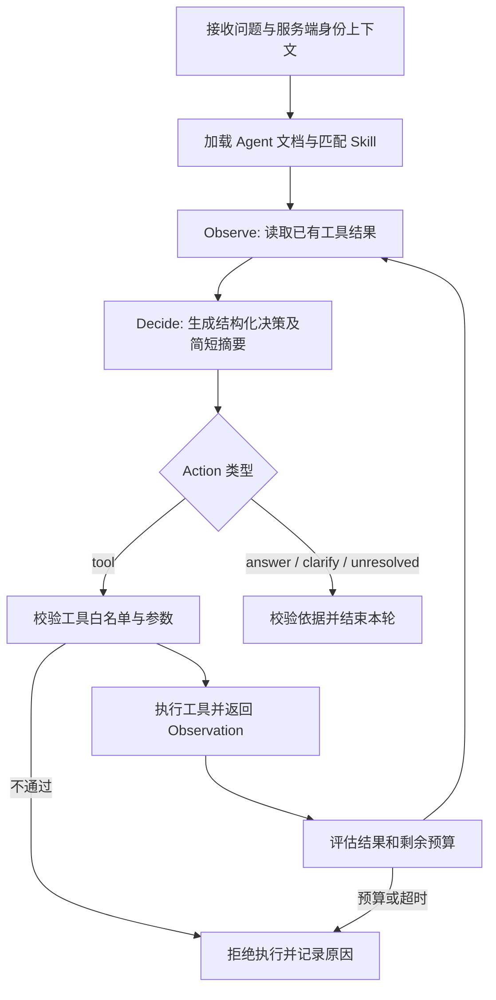

# 品牌投放客服 ReAct 架构

仓库名称：`consultant-react-agent`。文档入口：[架构与边界](docs/architecture.md)、[工具合同](docs/tool-contracts.md)、[Skill维护](docs/skill-authoring.md)、[运行排障](docs/runbook.md)、[链路验收](docs/acceptance.md)。

根据 [PRD](https://wcnendova4rf.feishu.cn/docx/DHaDdkHSHogqKfx1ymXch6zrnmU) 的文档体系及执行循环搭建的可运行框架。此处 ReAct 指推理与行动循环，页面使用原生 HTML，尚未引入 React 前端。

## 本地运行

在 PowerShell 中：

```powershell
cd D:\cst_proj\agent_service
..\.venv\Scripts\python.exe -m pip install -e ".[test]"
..\.venv\Scripts\python.exe -m ad_agent "查询素材 M0001 在 2026-03-24 的消耗与ROI" --trace --export examples/demo_trace.jsonl
..\.venv\Scripts\python.exe -m uvicorn ad_agent.app:create_app --factory --host 127.0.0.1 --port 8765
```

打开 http://127.0.0.1:8765 。默认不需要模型密钥，使用确定性 DemoProvider 和合成业务数据，可查看执行 Trace 并导出 JSONL。DemoProvider 用于验证架构，不是语言模型，也不会因修改文案自动学习新的业务推理。

## 执行链路



每个阶段同步持久化 Trace，供 HTTP 轮询、SSE 和 CLI 查看。循环含行动次数、模型/工具超时、整轮超时、有限重试和重复动作检测。

## 文档如何自定义

```text
profiles/default/
  AGENTS.md                 总角色、约束、启用技能及工具白名单
  skills/knowledge/SKILL.md  规则和指标查询步骤
  skills/material/SKILL.md   素材数据查询步骤
  skills/clarify/SKILL.md    模糊进线与单一假设确认
  skills/diagnose/SKILL.md   数据异议与纠错
  skills/feedback/SKILL.md   明确反馈与解决边界
  skills/handoff/SKILL.md    人工策略扩展点约束
  knowledge/metrics.json    带版本和引用编号的业务知识示例
```

Agent 文件示例：

```yaml
---
name: my-agent
skills: [knowledge, material, clarify, diagnose, feedback, handoff]
tools: [search_knowledge, resolve_material, get_material_status, get_material_daily_performance, get_customer_context, handoff_record]
---
此处写角色、约束及回答标准。
```

Skill 文件必须有 `name`、`description`、`triggers`、`tools` 的 YAML 头，正文写执行步骤。Skill name 与目录相同；tools 只能是 Agent 允许且代码已注册的工具。文档属于部署配置，普通用户不能上传文档修改运行权限；Skill 不能执行任意脚本。每份文档最大64KB，最多20个技能。当前结合保守意图解析、槽位续接和关键词路由，未命中走 clarify；新增技能需要设置准确的触发词，复杂语义路由可替换 `Profile.select`。

复制 profile 目录后设置 `$env:AGENT_PROFILE_DIR="D:\your-profile"`，重启服务生效。Trace 保存加载的文档哈希，以便复现。真实模型会读取 Agent 和选中 Skill 的正文。知识目前是关键词检索的 JSON 接口，可替换为带权限和版本信息的 RAG 检索器。

## 接入模型及业务数据

使用支持 `/chat/completions` 与 JSON object 输出的模型服务：

```powershell
$env:AGENT_PROVIDER="compatible"
$env:MODEL_BASE_URL="https://your-provider.example/v1"
$env:MODEL_NAME="your-model"
$env:MODEL_API_KEY="your-key"
$env:AGENT_API_TOKEN="your-local-api-token"
```

重启服务，在调试台输入 API Token。`.env.example` 仅列出配置项，不自动加载；不要将真实密钥写进 Agent/Skill 文档。真实模型适配器已经过模拟 HTTP 协议测试，未使用真实密钥进行联网效果评测。

默认 `fixtures/business.json` 是明确标注的合成数据。设置 `AGENT_BUSINESS_DB` 可切换到由 dump 提取的 SQLite，只读连接，要求含 `materials` 和 `material_daily_trend_cache` 的对应字段；不是直接读取 PostgreSQL `.dump`。SQL 模板固定，素材与日报均限定服务端提供的 advertiser_id。真实账号身份映射尚需接入；当前 Web/CLI 使用固定演示身份 B1/A1，因此不能直接作为多客户生产服务。

`get_customer_context` 默认返回空，也支持通过 `AGENT_CUSTOMER_CONTEXT_FILE` 接入受信后台记录，筛选新鲜且授权的一项候选并等待确认；`handoff_record` 当前明确返回策略未接入，不生成虚假交接记录。对话当天基准日由服务端按 Asia/Shanghai 生成，历史示例查询请使用示例日期。

## Trace 内容

事件包含递增 seq、UTC timestamp、type 和 payload：

| 事件 | 主要内容 |
|---|---|
| run_started / documents_loaded | 输入、受信上下文、模式、Agent/Skill 版本、允许的工具 |
| context_resolved | 意图、绝对日期槽位、继承与人工请求标记 |
| plan_started / decision | 迭代、重试次数、决策摘要、所选 Action、耗时 |
| action | 工具名称及校验后的参数 |
| observation | OK/PARTIAL/EMPTY/ERROR、结果、依据编号、耗时 |
| evaluation | 结果状态、下一步和剩余预算 |
| retry / guard_rejected / error | 重试或拦截原因，不记录原始服务商错误正文 |
| run_finished | 回答、状态、实际引用、动作数、终止原因、总耗时 |

这里的“思考过程”通过简短决策摘要及可验证的执行轨迹体现，不记录隐藏思维链。服务默认保存到 `var/runtime.sqlite`，CLI/页面可导出 JSONL。常见密钥字段及 Bearer 字符串会脱敏；业务问题和业务查询结果仍属于敏感业务信息，日志留存与访问权限需由部署方配置。非标准格式密钥不要放进对话。

请求 ID 相同且输入一致时返回缓存，不重复执行；输入变化会返回409。进程中断遗留的 RUNNING 请求需要检查 Trace 后更换请求 ID。不同调用者无法跨 owner 获取 Trace。当前 owner 来自固定演示身份，生产环境需要替换为真实鉴权上下文。

接口：`POST /api/run`，`GET /api/traces/{request_id}`，`GET /api/traces/{request_id}/stream`。请求体为 `message`、`request_id`（8–80位字母数字、下划线或连字符）、`session_id`。配置 API Token 后发送 `Authorization: Bearer ...`。

## 当前交付范围与扩展位置

已实现文档加载/校验/版本标记、技能匹配、ReAct 工具循环、规则检索、授权素材查询、精确金额计算、Trace 持久化与导出、模型适配器及最小调试页。回答引用校验检查引用是否真实来自工具，不能代替答案语义正确性评测。

这是支持继续实现 PRD 的架构基础，不是完整业务交付。`session_id` 现支持用户+品牌+线程隔离的槽位、候选和最后回答状态持久化，30分钟无交互后过期；基础明确反馈可确认上一回答。完整多事项关系与真实行为平台仍需接入；约3次有效解决尝试、历史转人工资格、交接记录接服务端持久化策略与 `handoff_record`；静默窗口、跨会话同问题重开和计数撤销仍需接独立事项状态机。现有循环预算不能当作人工拦截次数。真实知识库与账号映射、净ROI口径、多轮评测集需要继续接入。

测试命令：`..\.venv\Scripts\python.exe -m pytest -q`。测试覆盖业务分支、零值/NULL/缺失、越权与参数、循环预算、重试超时、文档修改、伪造引用、幂等、Trace隔离、模型协议与HTTP/SSE。

已建立 GitHub 远程仓库 `consultant-react-agent`，项目修改按检查与同步→修改验证→提交→推送执行。根目录 `.gitignore` 已排除 dump、数据库、运行日志、虚拟环境与 `.env`；以后同步时应仅选代码和示例文档，勿将现有业务资料整目录提交。

离线链路验收：`..\.venv\Scripts\python.exe -m ad_agent.evals`，使用固定日期与合成数据验证10个场景、22轮连续交互；报告保存在 `var/eval_report.json`。
