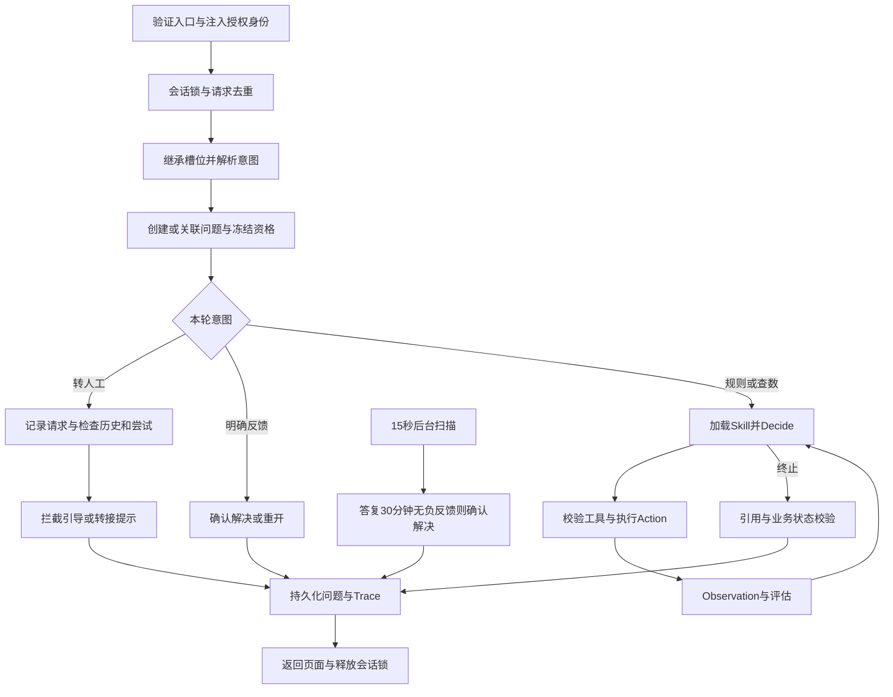

# consultant-react-agent 架构

产品目标：优先解决品牌方投手问题，再减少人工请求。本地实现规则以[业务决策清单](decisions.md)为准；本次未改写飞书PRD。

| 模块 | 职责 |
|---|---|
| profiles/default/AGENTS.md | 总角色、约束、Skill与工具白名单 |
| skills/*/SKILL.md | 知识、素材、批量排行、模糊进线、复核、反馈和人工策略说明 |
| knowledge/*.json | 来源、版本、范围明确的知识条目，当前为关键词检索 |
| conversation.py | 保守意图、日期、对象、排行条件、分页与反馈解析 |
| sessions.py | 用户+品牌+会话隔离的槽位存储与跨进程互斥；不因30分钟闲置过期 |
| support.py | 问题账本、30分钟静默认定/重开、有效尝试、历史请求去重及冻结资格 |
| engine.py | 服务端策略、ReAct、参数/引用校验、预算、Trace与状态输出 |
| tools.py / analytics.py | 授权数据读取、Decimal计算、批量、排行、达人报表与分页 |
| providers.py / codex_provider.py | 固定规则、兼容API、本地CLI三种结构化决策器 |
| trace.py | 请求幂等、事件记录与脱敏 |
| frontend | React表单、聊天、指标/表格、执行Trace、状态轮询和新会话 |

查数支持单素材、批量、排行、达人汇总；日期修正与分页继承已有条件，新知识话题不继承素材。最近7天包括当天。数据只读、固定参数接口，模型不生成SQL或改变身份。达人和素材使用各自日报。

执行Trace记录摘要、Action、Observation、预算评估、转人工资格和问题重开，不记录模型隐藏思维链。状态接口GET /api/support/{session_id}展示账本当前状态，历史run_finished保留当时结果，不改写审计历史。后台扫描停机时不运行，重启/访问状态时补算。

当前模型仍默认DemoProvider，复杂语言理解需真实模型评测。正式业务登录、真实人工系统、行为平台与跨会话语义事项关联尚未接入。SQLite请求结果与槽位保存不是跨所有表的单个事务，进程在关键写入间崩溃仍需核对Trace；线程锁租约允许故障恢复。
