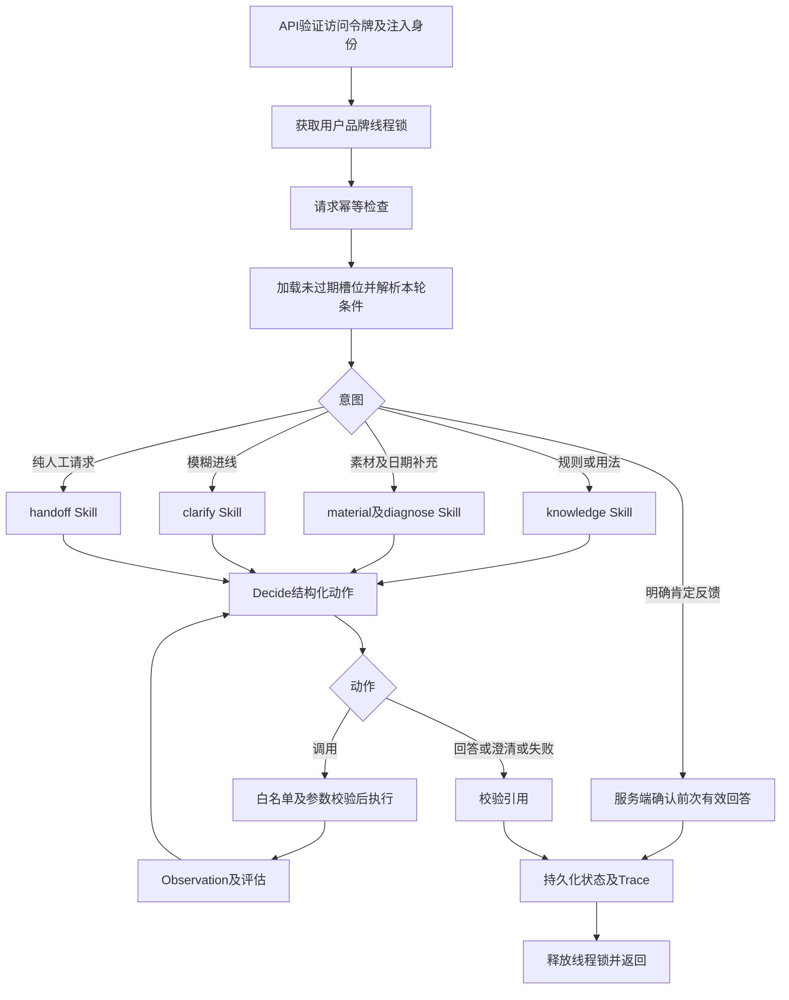

# consultant-react-agent 架构与边界

依据：项目PRD V1.2（2026-11-12本地快照）。产品目标为先正确解决品牌方投手的业务问题，再减少人工请求。本轮未改写飞书PRD。

## 模块职责

| 模块 | 职责 | 不允许代替的职责 |
|---|---|---|
| AGENTS.md | 总角色、约束、启用Skill和工具权限 | 不能新增可执行工具或授予业务权限 |
| skills/*/SKILL.md | 触发、输入条件、步骤、Observation分支、输出及验收 | 不以自然语言承诺未实现的服务端策略 |
| knowledge/*.json | 版本化业务事实/项目约定，附来源、范围、假设 | 不把历史AI答复当正确答案 |
| conversation.py | 显式意图、槽位及保守多轮继承 | 不解析任意身份、任意SQL；非完整语义理解器 |
| sessions.py | 用户+品牌+线程隔离的槽位存储、30分钟过期及执行互斥 | 非完整PRD事项账本或冻结资格服务 |
| engine.py | ReAct、工具校验、预算、引用检查、反馈状态与Trace | 不输出隐藏思维链，不证明语义正确性 |
| tools.py | 固定参数接口、实时范围校验、查询、Decimal计算 | 不执行模型生成的SQL，不修改投放 |
| providers.py | 确定性演示或兼容模型的结构化决策 | Demo不是模型效果评测 |
| trace.py | 事件持久化、重放、脱敏及请求幂等 | 不是公开的业务数据共享渠道 |

## 执行顺序

事件 `context_resolved` 记录意图、槽位、是否继承、人工请求标记；`documents_loaded` 记录Agent/Skill哈希及知识快照哈希。启动时固定文档与知识版本，修改后重启。模型调用只接收本轮观察及有限的前次槽位，不把完整历史正文无界塞进提示词。

## 多轮规则

日期单独回复、明确指代和数据异议可继承前次素材；新规则话题清空素材槽位；新明确素材查询无修正词时重新收集日期。相对日期每条消息按上海当天转换，旧绝对日期不自动漂移。“近7天”为前7个完整日。多个素材/超过两个日期不任意选取。

反馈仅保守识别精确肯定短语，且前次必须为ANSWERED_WAITING。否定不确认解决；反馈后仍保留可用于追问的素材槽位。此处状态只是当前线程状态，尚无完整事项级确认/重开计数与静默任务。

30分钟过期是当前槽位续接范围，不等于PRD规定的用户+品牌服务会话。Web使用浏览器保存的演示线程ID；刷新保留线程，换浏览器/CLI线程可能不同。生产必须由服务端建立服务会话，禁止客户端通过新线程绕过历史资格。

SQLite线程锁跨Engine实例共享；同线程并发返回409，不覆盖槽位。锁租约长于整轮超时30秒，进程崩溃后自然过期。已崩溃的请求ID仍保持RUNNING，检查Trace后使用新ID；不伪造事务已完成。运行结果和槽位当前分两次事务保存，崩溃瞬间可能需要人工核验，非严格端到端事务系统。

## 明确未完成项

| PRD能力 | 当前状态 | 后续接入 |
|---|---|---|
| 真实鉴权及品牌映射 | 固定演示身份，API Token仅保护入口 | 登录声明验证、每次获取实时账户权限 |
| 规则问答 | 24条项目约定及关键词检索 | 业务审核、正式知识源及RAG效果评测 |
| 素材查询 | 主键状态、整体日报、空值/覆盖 | 标题候选分页、不同ID类型映射、净ROI |
| 模糊进线 | 可选受信JSON上下文，单候选确认/否认 | 行为平台适配及事项级澄清预算 |
| 多轮 | 槽位与明确反馈持久化 | 多事项关系、跨会话重开及歧义关联 |
| 解决认定 | 明确肯定短语 | 24小时静默调度、撤销解决计数 |
| 人工策略 | 纯请求失败关闭，混合问题先自助 | 历史请求事件、冻结资格、有效尝试和幂等交接记录 |
| 模型评测 | Demo回归+模拟HTTP协议 | 真实模型/知识/数据端到端质量、时延和成本评测 |

不得将上述未接入项描述为上线能力，尤其不能以ReAct的调用次数代替人工有效尝试次数。
